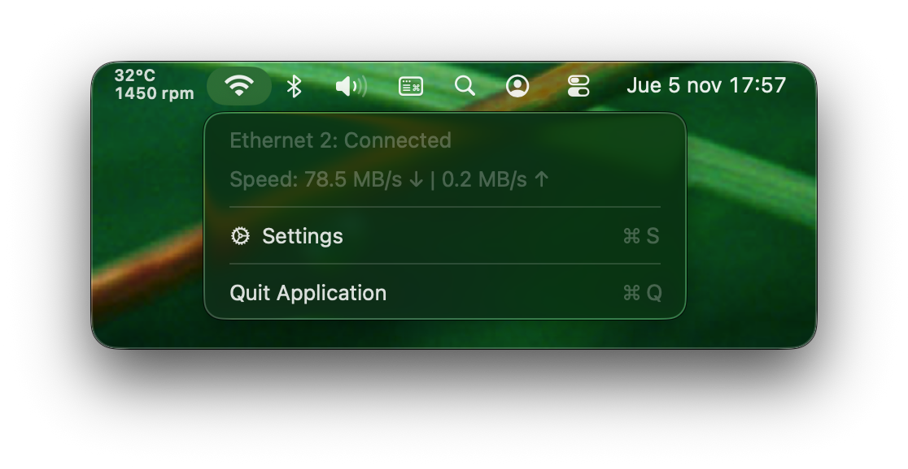
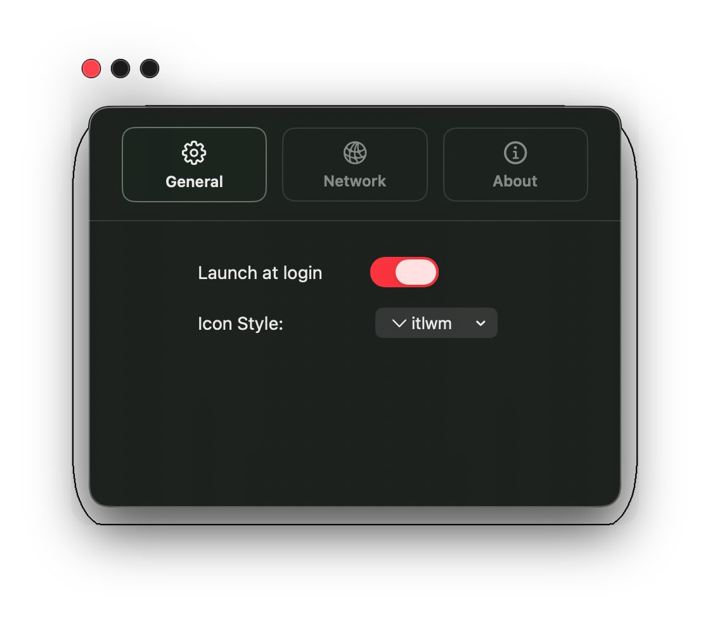
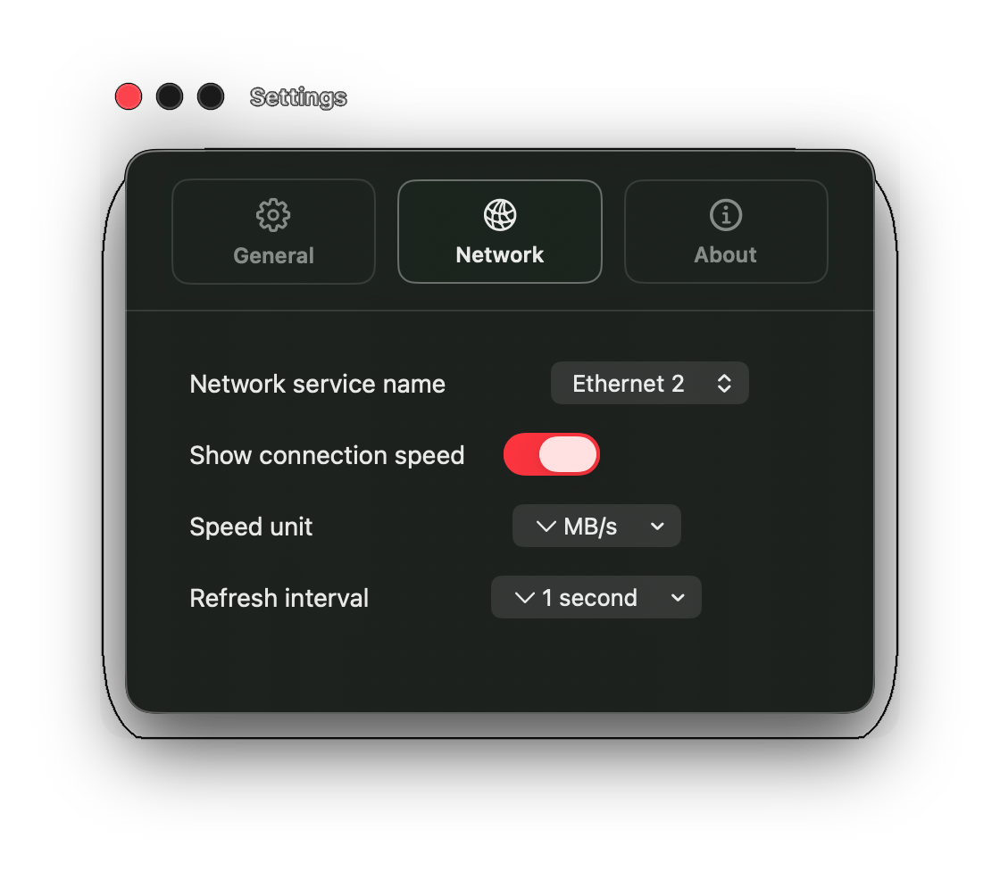
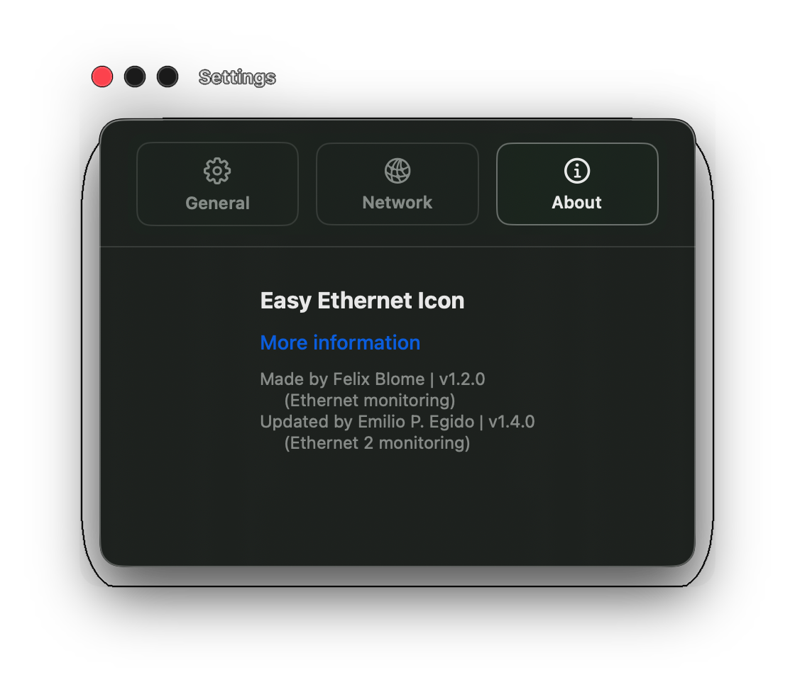

# Easy Ethernet Icon for macOS

A simple and lightweight macOS menu bar application that shows your Ethernet connection status at a glance. Developed by [felixblome](https://github.com/felixblome).

Designed to monitor only the system's Ethernet interface, a setting has been added that allows the user to choose between two Ethernet interfaces:

- `Ethernet` (built-in primary interface)
- `Ethernet 2` (interface created by `Heliport.app` + `itlwm.kext` to use Intel Wi-Fi cards not natively supported by macOS).

You can see [here](Fork-repo-differences.md) the differences between the source repo and this fork.

## Motivation

I have developed this fork because the user *laobamac* recently released a version of [itlwm.kext](https://github.com/laobamac/itlwm) that does not require HeliPort to function. This is beneficial as it noticeably speeds up the internet connection—making it available even before reaching the desktop. 
However, a drawback is that there is no Wi-Fi icon in the menu bar. This app provides a Wi-Fi icon for the menu bar with two states: connected and disconnected. Since it also monitors the 'Ethernet 2' connection, I appreciate having this icon visible. It is essentially a cosmetic detail, but without the Wi-Fi icon, it feels like something I’m accustomed to is missing. 
On the other hand, this app does not interact in any way with itlwm or the Wi-Fi stack, and it does not interfere with the operation of this connection.

## Screenshots

|     |     |
| --- | --- |
|  |  |
|  |  |

## Features

- 🔌 Live ethernet connection status monitoring
- 📊 Live connection speed monitoring 
- 🎯 Choose whether to monitor the `Ethernet` or `Ethernet 2` macOS network service
- 🎨 Choice between macOS, Windows and itlwm style icons (the itlwm icon is intended for Hackintosh systems using HeliPort + itlwm)
- 🚀 Launch at Login support
- 💎 Liquid glass style in settings window.

## System Requirements

- macOS 13.5 or newer.

## Installation

1. Download the latest release from the releases page
2. Unzip the downloaded file
3. Drag the app to your Applications folder
4. Double click to start the app
5. (Optional) Click the menu bar icon and select Settings to customize.

## Usage

- The icon in the menu bar shows your current Ethernet connection status and (if enabled) the connection speed
- Click the icon to:
  - See connection status
  - See connection speed
  - Access Network Settings
  - Configure app settings
  - Quit the application
- In Settings → General, choose the icon style: macOS, Windows or itlwm.
- In Settings → Network, choose `Ethernet` for the built-in service or `Ethernet 2` for HeliPort + itlwm setups.

## Build from Source

If you want to build the app yourself:

1. Clone this repository
2. Open the project in Xcode
3. Ensure you have Xcode 15 or newer; the project is in the `Xcode-project` folder
4. Build the project (⌘B).

## Privacy

This app:

- Only monitors the ethernet connection status.

## Credits

Original project by [Felix Blome](https://github.com/felixblome/easy-ethernet-icon).
